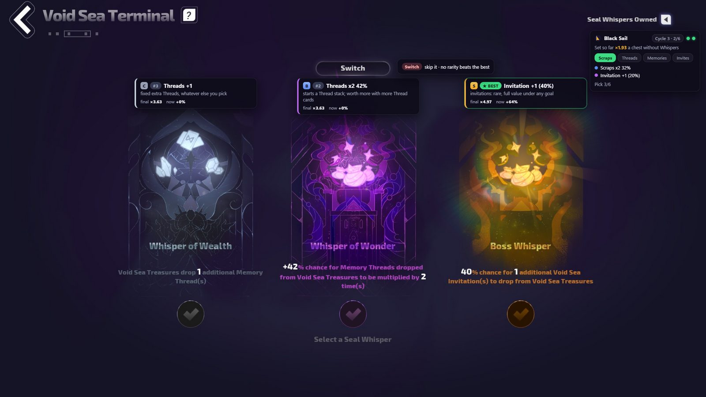
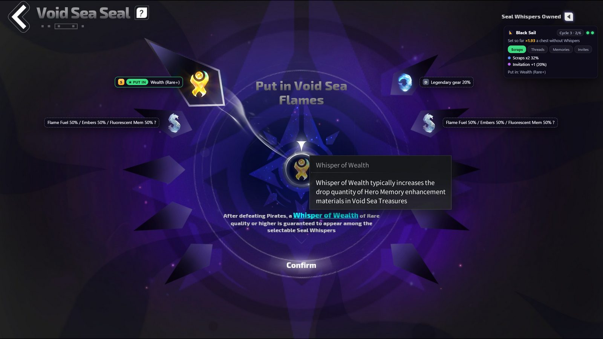
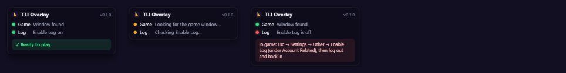
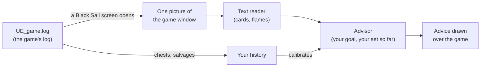

# TLI Overlay

**Black Sail advice for Torchlight: Infinite, right on top of your game.**

Pick the best Seal Whisper, put in the right flame, and see what your chest is worth: without alt-tabbing.

  

## ✨ What it does

- 🃏 **Ranks every Seal Whisper card.** Each card gets a tier (S to D), a rank and a short reason. The best pick for your whole 6-card set is marked **★ BEST**.
- 🔁 **Tells you if Switch is worth it.** Before you press Switch: the chance it beats your best card. After: whether the Switch card is better or worse.
- 🔥 **Labels the flames.** On the Void Sea Seal screen every flame is named, and the one to put in is marked **★ PUT IN**.
- 🎯 **Farms what you want.** Choose Scraps, Threads, Memories or Invites for each cycle, and the advice follows.
- 📦 **Checks your chests.** After each Void Sea Treasure it shows what you got against what was expected.
- 📈 **Learns from your play.** It calibrates itself from your own chests and salvages. Nothing to set up.

## 📥 Download and install

1. Download **`TLI-Overlay-<version>-win-x64.zip`** from the [latest release](https://github.com/danthespal/tli-overlay/releases/latest).
2. Unzip it into a folder of your choice (for example `Documents\TLI Overlay`).
3. Run **`TLI Overlay.exe`**.

> [!NOTE]
> Windows may say *"Windows protected your PC"*, because the app isn't signed. Click **More info → Run anyway**.

No installer, no admin rights. Your data stays in a `data` folder next to the exe. To update, unzip the new version over the old one, or move your `data` folder across.

## 🎮 Before you play: turn on the game's log

The overlay knows what's on screen by reading the game's own log. The game only writes the lines it needs when its log is turned on:

1. In game, press **Esc → Settings → Other**.
2. Under **Account Related**, click **Enable Log**. The game shows *"Log Enabled"*.
3. **Log out and back in** (Return to login screen).

> [!IMPORTANT]
> The game doesn't remember this setting. After you close it, press **Enable Log** again the next time you play. The overlay tells you when it's needed.

## 🚦 Ready to play?

When you start the game, a small card in the top-right corner shows two lights:

| Light | 🟢 Green | 🟡 Amber | 🔴 Red |
|---|---|---|---|
| **Game** | The game window was found | Looking for the game | — |
| **Log** | The game's log is on | Checking (up to 2 minutes) | Turn on Enable Log (the card says how) |

When both are green it says **✓ Ready to play** and gets out of your way. Open a Black Sail screen and the advice appears by itself.

The overlay is click-through: your clicks go to the game, except on the panel itself.

## 🧭 The tray icon

Right-click the sail icon next to the clock:

- **Choose UE_game.log…** if your game is installed somewhere unusual (normally it's found by itself)
- **Share anonymous data** on or off
- **Report a wrong read** (or press **Ctrl+Shift+R** in game)
- **Show what was shared** and **Delete my shared data**
- **Quit**

## 🔒 Safe and private

- **Read-only.** It never touches game memory, your keyboard or mouse, or the game's files. It only reads the game's log, and takes a picture of the game window when a Black Sail screen opens.
- **Pictures are thrown away** as soon as they're read. Only the last one is kept, in your temp folder, so you can report it if it was read wrong.
- **Sharing is your choice.** At first start it asks once whether to share anonymous Black Sail data (cards offered, picks, chest drops, what was read, screen size) to improve the advice for everyone. Never the game log, screenshots, your Steam ID or names. Nothing is sent unless you say yes, and you can turn it off or delete what you shared at any time.
- **Reports are separate.** *Report a wrong read* shows you the picture and what was read, and sends them only when you press **Send**.

## ❓ Troubleshooting

<b>The Log light stays red</b>

Turn on the game's log (Esc → Settings → Other → Enable Log), then log out and back in. If it's on and still red, the game may be writing its log somewhere else: use the tray icon → **Choose UE_game.log…** and pick `UE_game\TorchLight\Saved\Logs\UE_game.log` in your game folder.

<b>I don't see the overlay over the game</b>

Use **borderless** or **windowed** mode in the game's graphics settings: Windows doesn't draw other windows over exclusive fullscreen.

<b>A card or flame was read wrong</b>

Press **Ctrl+Shift+R** right after, say what's wrong, and press **Send**. Those reports are how the reader gets better.

<b>The game runs as administrator</b>

Windows then won't let other apps share the game window, so the overlay falls back to a plain screen picture, which only works while the game is in front. Start the game normally, or run the overlay as administrator too (right-click → Run as administrator).

<b>How do I uninstall it?</b>

Quit it from the tray icon and delete its folder. Windows also keeps a small cache for it (about 8 MB) in `%APPDATA%\tli-overlay`, which you can delete too. Nothing else is installed.

## ⚙️ How it works

Want to build it yourself or help? See **[docs/DEVELOPMENT.md](docs/DEVELOPMENT.md)**.

## 📄 License

[MIT](LICENSE) © 2026 Arsenic

*TLI Overlay is a fan-made tool. It isn't affiliated with or endorsed by XD Inc. or the makers of Torchlight: Infinite. Game names and images belong to their owners.*
