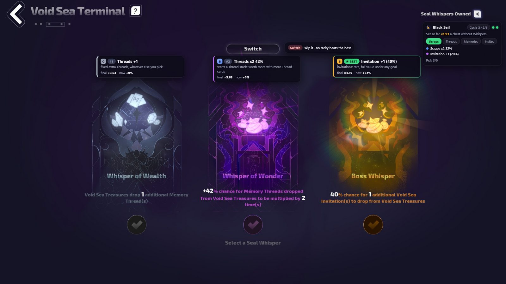
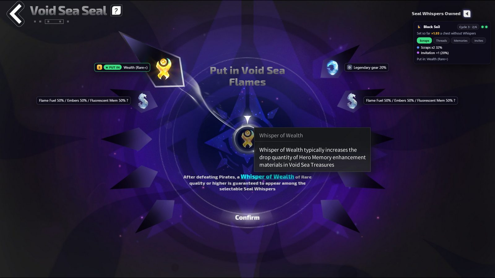
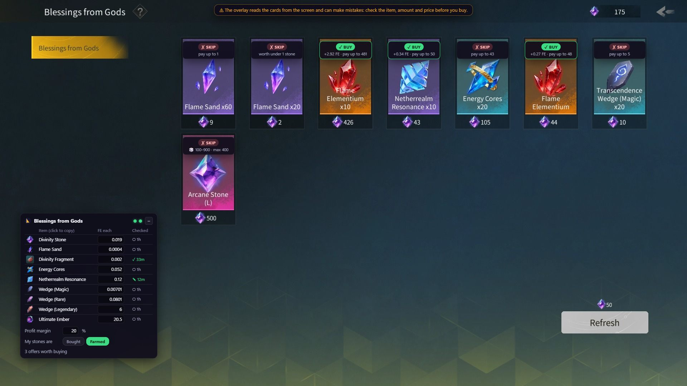
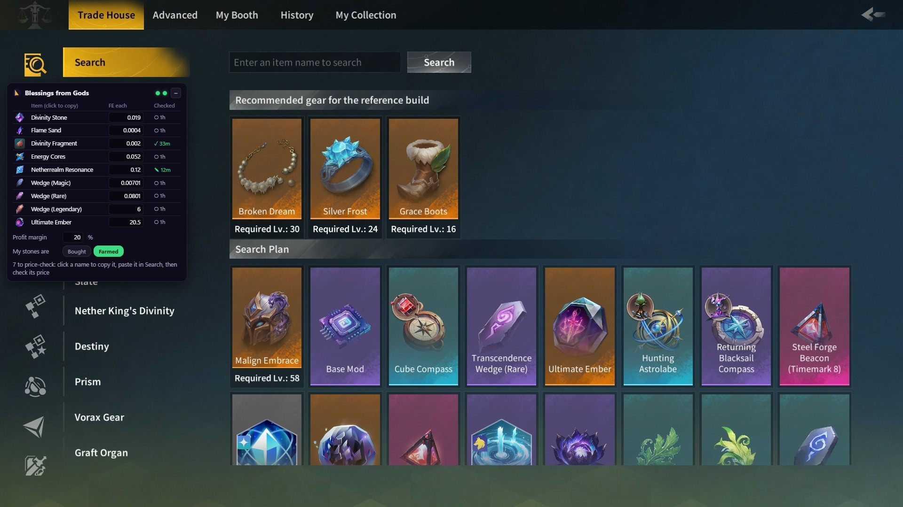
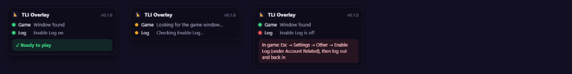
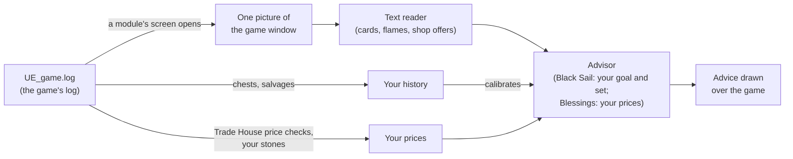

# TLI Overlay

**Advice for Torchlight: Infinite, right on top of your game.**

Pick the best Seal Whisper in Black Sail, buy only the Blessings from Gods offers worth their Divinity Stones, and see what you got: without alt-tabbing.

   

## 🧩 Modules

The overlay has one module per game mechanic. Each one wakes up by itself when its screen opens in the game, and stays out of the way otherwise.

| Module | Where | What you get |
|---|---|---|
| ⛵ [**Black Sail**](#-black-sail) | Seal Whisper and Void Sea Seal screens | The best card and flame for your goal, your cycle, your chests |
| 💎 [**Blessings from Gods**](#-blessings-from-gods) | The Divinity Stone shop and the Trade House | **✓ BUY** or **✗ SKIP** on every offer, from your own Trade House prices |

### ⛵ Black Sail

- 🃏 **Ranks every Seal Whisper card.** Each card gets a tier (S to D), a rank and a short reason. The best pick for your whole 6-card set is marked **★ BEST**.
- 🔁 **Tells you if Switch is worth it.** Before you press Switch: the chance it beats your best card. After: whether the Switch card is better or worse.
- 🔥 **Labels the flames.** On the Void Sea Seal screen every flame is named, and the one to put in is marked **★ PUT IN**.
- 🎯 **Farms what you want.** Choose Scraps, Threads, Memories or Invites for each cycle, and the advice follows.
- 📦 **Checks your chests.** After each Void Sea Treasure it shows what you got against what was expected.
- 📈 **Learns from your play.** It calibrates itself from your own chests and salvages. Nothing to set up.

### 💎 Blessings from Gods

- 💎 **Judges every offer.** Each card gets **✓ BUY** with the profit, or **✗ SKIP**, with the most stones worth paying for it. It reads the item, the amount and the stone price straight from the card.
- 🔄 **Keeps up with Refresh and Buy.** After a Refresh the badges show *Reading…* and the new verdicts appear about a second later. A bought card shows *Sold out* and loses its badge.
- 🪙 **Knows your stones.** A good offer you can't afford is marked in amber, *need 6 more stones*, and the panel shows how many you have.
- 🎲 **Values the Arcane Stones** (a random 50–350 or 100–900 Divinity Stones) at their average.
- 🏷️ **Uses your own prices.** Price-check an item in the Trade House once and the overlay remembers it. Or type a price yourself.

**Setting up your prices** takes a minute in the Trade House:

1. Open the Trade House: the price table appears on the left as a checklist.
2. Click an item's name in the table: it's copied, ready to paste in **Search** (cut to the 16 characters the box takes).
3. Search, open the item, and check its price. Its row turns green **✓**.

| In the table | Means |
|---|---|
| **✓ 12m** (green) | Price-checked in the last hour |
| **○ 3h** (grey) | Checked today |
| amber | Older than a day: check it again |
| **✎ now** | A price you typed (click the box, type, press Enter) |
| **● check** | No price yet |

The price kept for an item is the one **most sellers ask** among the cheapest listings, not the single cheapest one. Under the table:
- **Profit margin** (default 20%): how much more an offer must be worth than it costs.
- **My stones are Bought / Farmed**: bought stones cost their Trade House price; farmed ones cost what selling them would earn.

> [!WARNING]
> The overlay reads the cards from the screen and can make mistakes. Check the item, amount and price before you buy.

## 📥 Download and install

1. Download **`TLI-Overlay-<version>-win-x64.zip`** from the [latest release](https://github.com/danthespal/tli-overlay/releases/latest).
2. Unzip it into a folder of your choice (for example `Documents\TLI Overlay`).
3. Run **`TLI Overlay.exe`**.

> [!NOTE]
> Windows may say *"Windows protected your PC"*, because the app isn't signed. Click **More info → Run anyway**.

No installer, no admin rights. Your data stays in a `data` folder next to the exe. To update, unzip the new version over the old one, or move your `data` folder across.

## 🎮 Before you play: turn on the game's log

The overlay knows what's on screen by reading the game's own log. The game only writes the lines it needs when its log is turned on:

1. In game, press **Esc → Settings → Other**.
2. Under **Account Related**, click **Enable Log**. The game shows *"Log Enabled"*.
3. **Log out and back in** (Return to login screen).

> [!IMPORTANT]
> The game doesn't remember this setting. After you close it, press **Enable Log** again the next time you play. The overlay tells you when it's needed.

## 🚦 Ready to play?

When you start the overlay, a small card in the top-right corner of the game shows two lights:

| Light | 🟢 Green | 🟡 Amber | 🔴 Red |
|---|---|---|---|
| **Game** | The game window was found | Looking for the game | — |
| **Log** | The game's log is on | Checking (up to 2 minutes) | Turn on Enable Log (the card says how) |

The modules start once both are green: the card says **✓ Ready to play** and gets out of your way. Open a Black Sail screen or the Blessings from Gods shop and the advice appears by itself.

- **Click-through:** your clicks go to the game, except on the overlay's panels. Drag a panel by its title to move it, and fold it with **−**.
- **Out of the way:** while another window covers the game (Alt+Tab), the overlay hides. A window on your other monitor doesn't count.
- **Screen shape:** the readers are made for **16:9** (like 1920x1080). On another shape the card warns you that it may misread.

## 🧭 The tray icon

Right-click the sail icon next to the clock:

- **Choose UE_game.log…** if your game is installed somewhere unusual (normally it's found by itself)
- **Share anonymous data** on or off
- **Report a wrong read** (or press **Ctrl+Shift+R** in game)
- **Show what was shared** and **Delete my shared data**
- **Quit**

## 🔒 Safe and private

- **Read-only.** It never touches game memory, your keyboard or mouse, or the game's files. It reads the game's log, takes a picture of the game window when a Black Sail screen or the Blessings from Gods shop opens, and asks Windows which window is in front (to hide while you're elsewhere).
- **Pictures are thrown away** as soon as they're read. Only the last one is kept, in your temp folder, so you can report it if it was read wrong.
- **Prices stay on your PC.** They come from your own Trade House price checks in the game's log, and are kept in your `data` folder.
- **Sharing is your choice.** At first start it asks once whether to share anonymous Black Sail data (cards offered, picks, chest drops, what was read, screen size) to improve the advice for everyone. Never the game log, screenshots, prices, your Steam ID or names. Nothing is sent unless you say yes, and you can turn it off or delete what you shared at any time.
- **Reports are separate.** *Report a wrong read* shows you the picture and what was read, and sends them only when you press **Send**.

## ❓ Troubleshooting

<b>The Log light stays red</b>

Turn on the game's log (Esc → Settings → Other → Enable Log), then log out and back in. If it's on and still red, the game may be writing its log somewhere else: use the tray icon → **Choose UE_game.log…** and pick `UE_game\TorchLight\Saved\Logs\UE_game.log` in your game folder.

<b>I don't see the overlay over the game</b>

Use **borderless** or **windowed** mode in the game's graphics settings: Windows doesn't draw other windows over exclusive fullscreen. The overlay also hides while another window covers the game: click the game and it comes back.

<b>A shop card says "no price yet"</b>

The overlay hasn't seen a price for that item. Open the Trade House, click the item's name in the table, paste it in **Search** and check its price. Or type a price in the table.

<b>Shop cards say "close the pop-up to read"</b>

A card's pop-up (More / Buy) was open when the overlay read the shop, and it dims the other cards. Close the pop-up and the cards are read again.

<b>A card, flame or price was read wrong</b>

Press **Ctrl+Shift+R** right after, say what's wrong, and press **Send**. Those reports are how the reader gets better.

<b>The game runs as administrator</b>

Windows then won't let other apps share the game window, so the overlay falls back to a plain screen picture, which only works while the game is in front. Start the game normally, or run the overlay as administrator too (right-click → Run as administrator).

<b>How do I uninstall it?</b>

Quit it from the tray icon and delete its folder. Windows also keeps a small cache for it (about 8 MB) in `%APPDATA%\tli-overlay`, which you can delete too. Nothing else is installed.

## ⚙️ How it works

Want to build it yourself or add a module? See **[docs/DEVELOPMENT.md](docs/DEVELOPMENT.md)**.

## 📄 License

[MIT](LICENSE) © 2026 Arsenic

*TLI Overlay is a fan-made tool. It isn't affiliated with or endorsed by XD Inc. or the makers of Torchlight: Infinite. Game names and images belong to their owners.*
